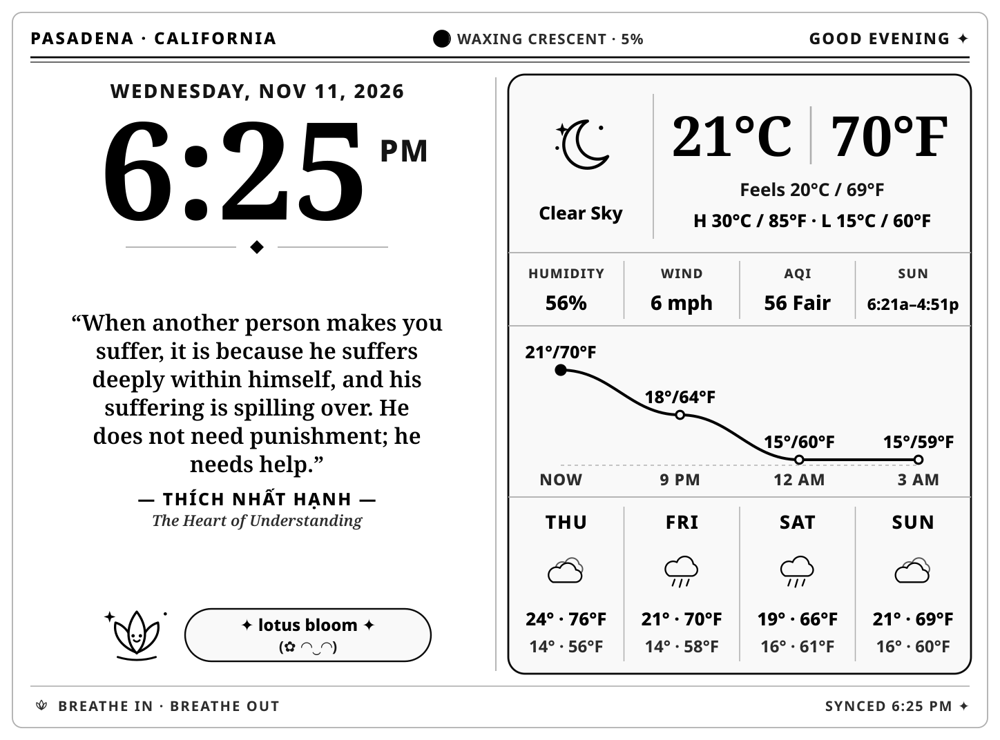

# paper-monk

> High-contrast 300 PPI E-Ink Zen desk clock, weather almanac, and touch-lit quote sanctuary for Kindle Paperwhite.



A high-contrast, **300 PPI E-Ink desk clock, weather almanac, and contemplative quote sanctuary** built for a jailbroken **Kindle Paperwhite 4 (`1072 × 1448`)** — running in **Featherweight Mode** with zero-CPU touch gestures.

## Highlights

- **Glasses-Free High-Contrast Typography:** Bold, crisp `300 PPI` vector SVG rendered via `rsvg-convert` + ImageMagick into native 8-bit grayscale E-Ink framebuffers.
- **Touch Gestures on the Glass (`0.0%` Idle CPU via LuaJIT `poll()` + `evdev`):**
  - **Single Tap:** Turns the Kindle frontlight **ON** (soft glow, auto-offs after `20s`) — or **OFF immediately** if tapped while lit. Stays completely dark (`0`) at night until touched.
  - **Triple Tap:** Rotates the dashboard **90° clockwise** through all 4 native orientations (`0°` Portrait USB-Bottom → `90°` Landscape USB-Right → `180°` Portrait USB-Top → `270°` Landscape USB-Left) without rebuilding or touching a computer.
- **Featherweight Linux Mode (`stop lab126_gui`):** Shuts down Amazon's heavy Java/WebKit UI while in Desk Mode, cutting Kindle RAM usage by >50% (`~132 MB` used) and preventing popups or sleep screens from ever overwriting the display. One click in the Web Studio restores the normal Kindle UI & KOReader anytime.
- **Dual-Scale Weather & Almanac (Open-Meteo):**
  - Side-by-side **Celsius (`°C`) & Fahrenheit (`°F`)** current, feels-like, and high/low temperatures
  - **Smooth Cubic Bezier Hourly Curve**, **US AQI**, **Humidity**, **Wind**, **Sunrise/Sunset**, and **Astronomical Moon Phase**
  - **4-Day Forecast** with custom vector E-Ink weather icons
- **75 Curated Contemplative Quotes + 12 Kawaii Zen Companions:**
  - **Alan Watts**, **Thích Nhất Hạnh**, **Ram Dass**, **Pema Chödrön**, and **Jon Kabat-Zinn**
  - 12 custom vector companions (`yuzu capybara`, `lotus bloom`, `pond friend`, `warm matcha`, `little bonsai`, `happy boba`, `zen kitty`, `sunny pup`, `go slowly`, `soft cloud`, `happy sprout`, `cozy spirit`)
- **Live Desk Studio (`http://localhost:8788`):** Browser studio to preview & switch orientations, Classic Paper / Dark Ink / Auto Day-Night themes, teachers, companions, `12h`/`24h` clock, frontlight mode, and Featherweight toggle.

---

## Architecture

```text
├── dashboard.py                 # Minute-aligned scheduler, Web Studio (:8788), /api/rotate, SSH auto-enroll & eips/fbink pusher
├── renderer.py                  # 300 PPI SVG + atomic rsvg-convert/ImageMagick 8-bit grayscale pipeline (all 4 rotations)
├── weather.py                   # Open-Meteo weather, US AQI, hourly curve & astronomical lunar phase with offline cache
├── quotes.py                    # 75 curated quotes + 12 kawaii/zen companions
├── config.json                  # Runtime configuration (location, orientation, theme, frontlight, SSH)
├── setup_usbnet.sh              # One-command Kindle KUAL/USBNetLite provisioner + NetworkManager usb0 setup
├── systemd/
│   └── kindle-dashboard.service # User systemd service
└── kindle-extension/
    └── kindle-dashboard/        # KUAL menu + LuaJIT FFI evdev touch-light & triple-tap rotation daemon
        ├── config.xml
        ├── menu.json
        └── bin/
            ├── dashboard_ctl.sh
            └── touch_light.sh
```

## Quick Start

1. **Dependencies (Arch / Linux Host):**
   ```bash
   sudo pacman -S python librsvg imagemagick openssh
   ```
2. **Enable Background Service:**
   ```bash
   mkdir -p ~/.config/systemd/user
   cp systemd/kindle-dashboard.service ~/.config/systemd/user/
   systemctl --user enable --now kindle-dashboard.service
   ```
3. **Connect Jailbroken Kindle (`USBNetLite` at `192.168.15.244`):**
   - Enable USBNetwork on the Kindle (`;un` in the search bar), plug into USB, and run:
     ```bash
     ./setup_usbnet.sh
     ```
   - Open **`http://localhost:8788`** to customize your display, or **triple-tap** the Kindle glass anytime to rotate 90° clockwise!
